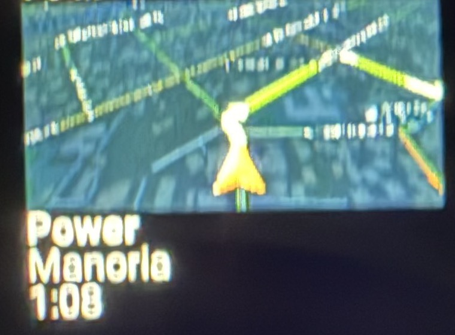

# Карта CarPlay на HUD (Geely Monjaro, ECARX KX11)

Небольшая карта из CarPlay на проекции лобового стекла (HUD) рядом с названиями улиц и треком из MConfig+.
Проверено: Geely Monjaro до рестайлинга, ГУ ECARX KX11 (Android 9), iPhone, CarPlay по USB, DiPlay 0.2.22 + наши
изменения (ветка `geely-hudinfo`), MConfig+ 48.2.

*Фото с проекции HUD ночью (кадр обрезан, названия улиц убраны).*

## Как это устроено

- ГУ рисует HUD из нижней части дисплея 2 (1920×1080, верхние 1920×720 идут на приборку). MConfig+ рисует
  свои строки как оверлей 728×190 в точке (0, 720).
- iPhone отдаёт отдельный поток для приборки (тип 111). Мы показываем его в окне 192×96 в точке (0, 762),
  в свободной полосе между улицами сверху и треком снизу.
- Поток запрашивается в 4 раза больше окна (768×384) и показывается уменьшенным. Если запросить ровно размер
  окна (192×96), в `/info` уходит физическая ширина 292 мм, iPhone считает экран крошечным, рисует огромные
  элементы и ставит машину в угол. Маркер машины: 30 % слева, только карта (`maps:/car/instrumentcluster/map`).
- Режим не трогает DIM приборки и не шлёт `hud.AAMAP_SHOWN/END`, поэтому mSpeed и штатная приборка остаются как были.

## Включение

- Кнопка SRC: в MConfig+ → «Кнопки» → SRC / WeChat → 1X → «Отправить намерение (broadcast)»,
  действие `com.shilapi.xcertplay.GEELY_CLUSTER_MAP_TOGGLE`, пакет `com.shihab.diplay`,
  «Отключить действие по умолчанию» включено. Каждое нажатие открывает или закрывает карту.
- Автоматически: Настройки DiPlay → Дополнительно → «Карта на HUD при навигации» (по умолчанию выключено).
  Карта открывается с началом маршрута и закрывается в конце; SRC остаётся приоритетным.

## Настройка из adb

`am broadcast -a com.shilapi.xcertplay.GEELY_HUD_MAP_MODE -p com.shihab.diplay` с параметрами
`--ez on false|true`, `--ez auto true|false`, `--ei x y w h` (окно в пикселях дисплея 2), `--ei k` (1–8, множитель потока),
`--es content map|instruments`, `--ei mx my sa` (положение машины и край, %). Изменения потока применяются
при следующем подключении. Тестовое окно с линейкой: `GEELY_HUD_TEST --ei x y w h --ei sec`.

## Ограничения

- Геометрия привязана к этой машине и к раскладке MConfig+ (улицы сверху, трек снизу); на другой прошивке
  окно придётся двигать.
- Скорость на HUD рисуется справа по центру и на скриншоте дисплея 2 не видна: окно ставьте только по
  тестовому окну и глазами.
- Камерой карты управляет iPhone, не мы.
- Запасной режим: `GEELY_HUD_MAP_MODE --ez on false` возвращает карту на приборку.

## Бонус: температура и запас хода

В правом нижнем углу HUD: наружная температура (датчик ECARX 1051392, °C) с пометкой «ЛЁД» при ≤3 °C
и запас хода (1054720, км) только когда он меньше 100 км (красным ниже 50). Значения сверены с приборкой.
